# Preguntados · Las Camisetas de Luifa

Juego de preguntas para el local: girá la ruleta, respondé **3 preguntas contra reloj** y, si acertás al menos **2**, sorteá una **gorra** o un **vaso**.

Esta versión es una reescritura completa del juego original en un solo HTML, ahora con una arquitectura moderna separada en **API REST (Spring Boot)** y **SPA (React + Vite)**, lista para subir a GitHub y desplegar.


## Contenido

- [Capturas](#capturas)
- [Características](#características)
- [Stack](#stack)
- [Arquitectura](#arquitectura)
- [Estructura del repositorio](#estructura-del-repositorio)
- [Requisitos](#requisitos)
- [Puesta en marcha local](#puesta-en-marcha-local)
- [Reglas y contenido](#reglas-y-contenido)
- [API](#api)
- [Tests](#tests)
- [Configuración](#configuración)
- [Docker](#docker)
- [Uso en el local (tablet / LAN)](#uso-en-el-local-tablet--lan)
- [Despliegue](#despliegue)
- [Seguridad](#seguridad)
- [Reset de datos](#reset-de-datos)
- [Licencia](#licencia)

## Capturas

| Inicio | Ruleta | Pregunta |
| :---: | :---: | :---: |
| 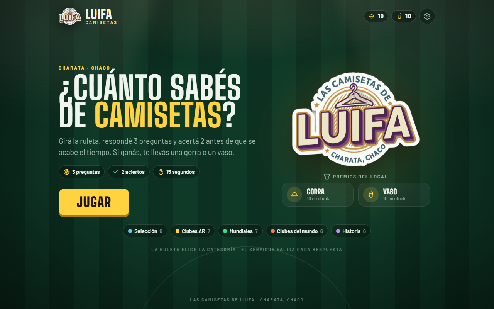 | 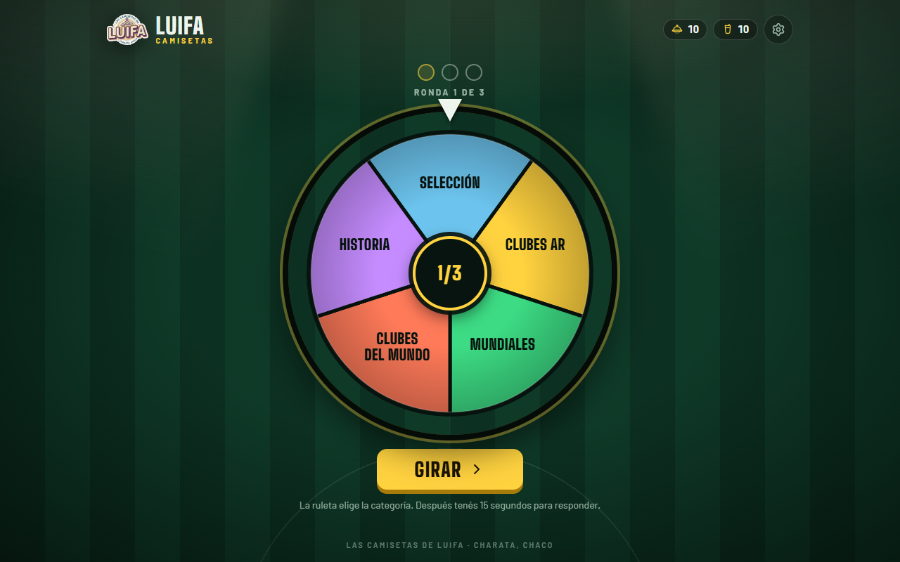 | 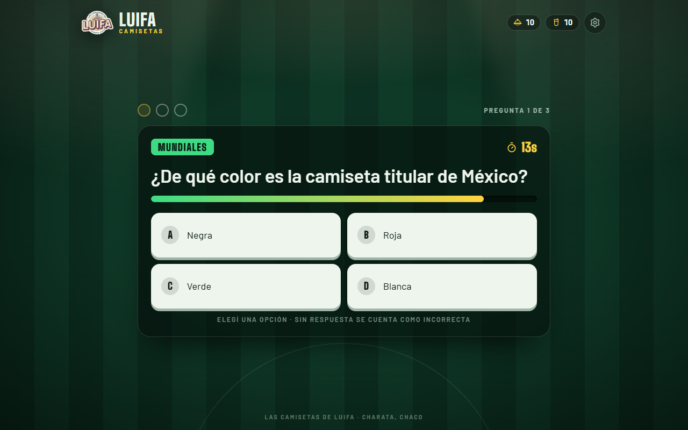 |
| **Respuesta** | **Resultado** | **Premio** |
| 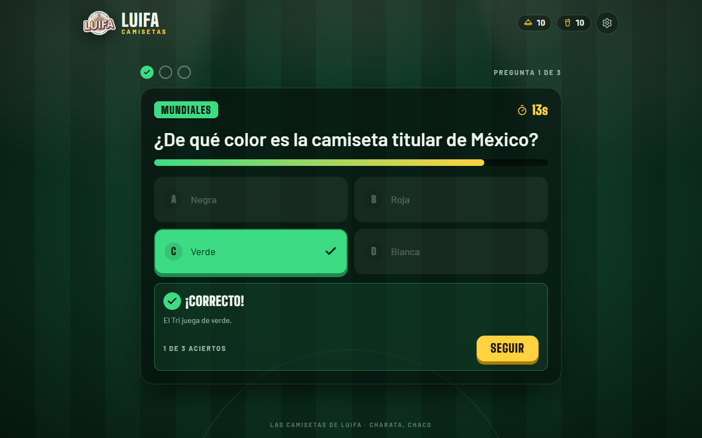 | 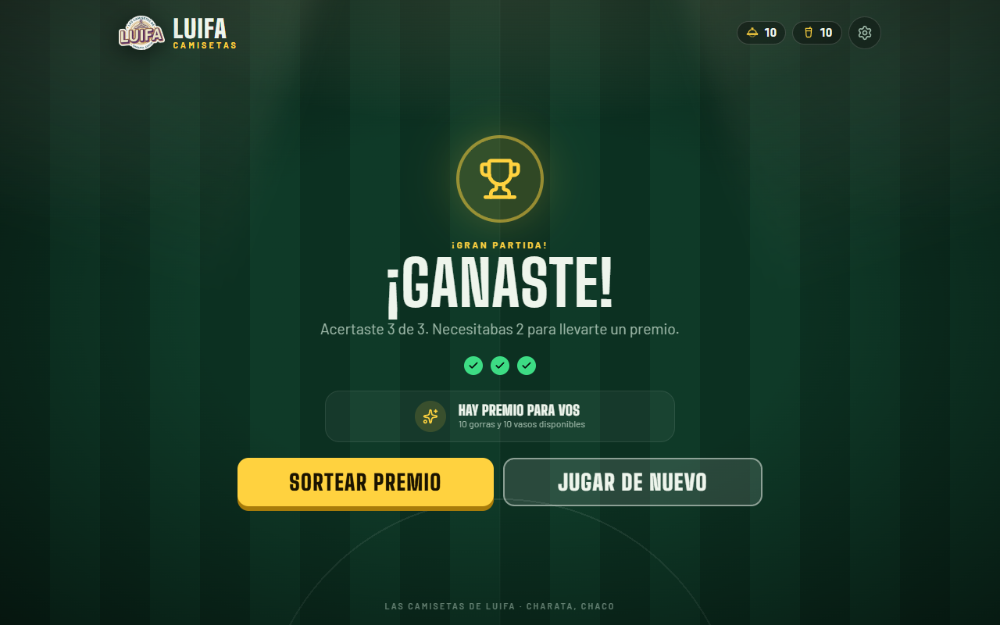 | 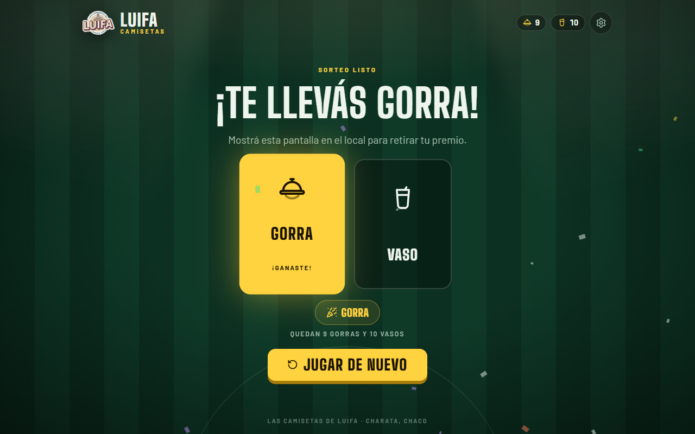 |
| **Sin premio** | **Acceso admin** | **Administración** |
| 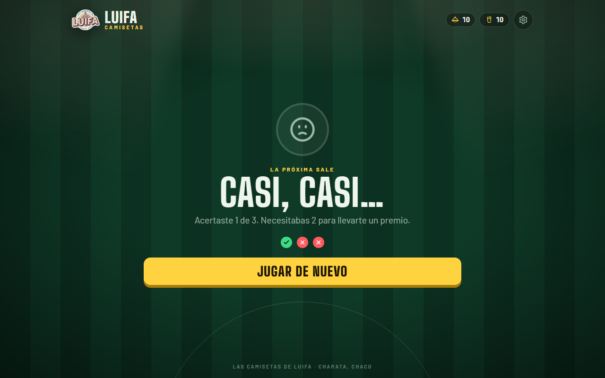 | 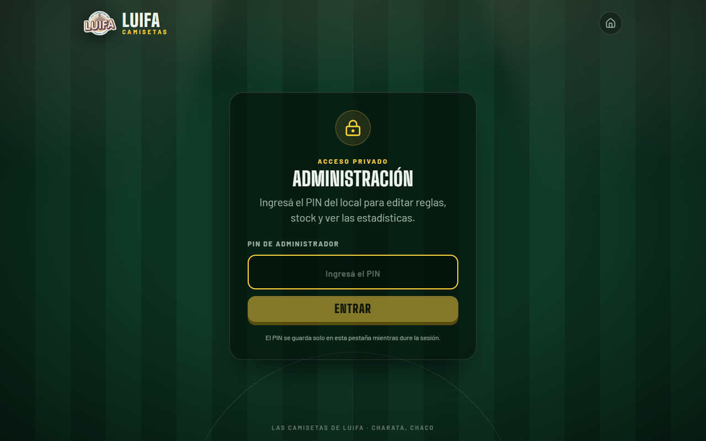 | 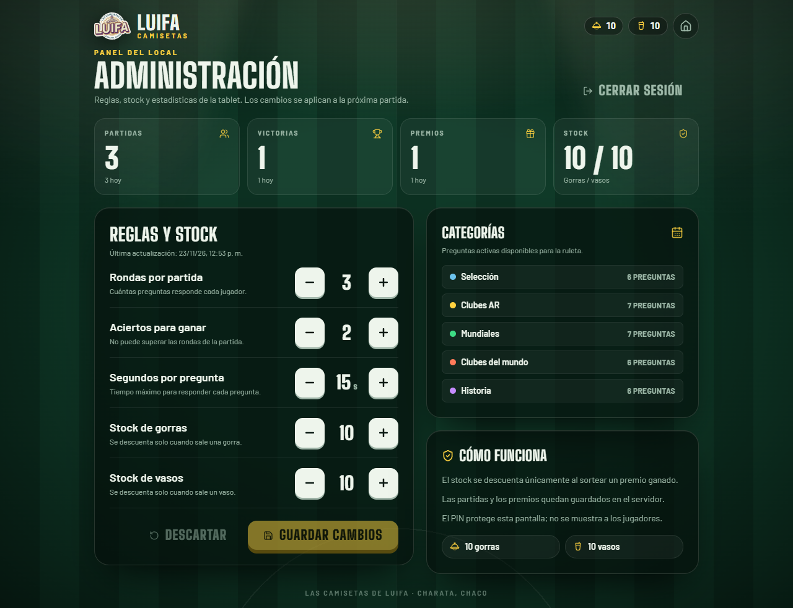 |

## Características

- **Partida completa:** ruleta de 5 categorías, 3 rondas, temporizador, feedback con dato curioso, resultado y sorteo de premio.
- **Servidor autoritativo:** el backend decide categoría, pregunta, orden de opciones, respuestas correctas, tiempos y premio. El cliente solo dibuja el estado.
- **Anti-trampa básico:** no se envían las respuestas correctas hasta responder; el tiempo se valida en el servidor (con 2 segundos de gracia por latencia).
- **Stock real:** las gorras y los vasos se descuentan únicamente al sortear un premio ganado. El sorteo es ponderado según las unidades disponibles.
- **Panel de administración:** reglas, segundos por pregunta, stock y estadísticas del local, protegido con PIN.
- **Idempotencia:** responder dos veces o reintentar el sorteo no duplica aciertos ni descuenta stock.
- **Responsive:** pensado para tablets en el local y también para celulares.
- **Accesibilidad:** navegación por teclado, foco visible, `aria-live`, respeto por `prefers-reduced-motion` y contraste alto.
- **Extras de experiencia:** confetti al ganar, wake lock para que la pantalla no se apague y animación de ruleta que siempre cae en la categoría elegida por el servidor.
- **Sin servicios externos:** todo corre con H2 (por defecto) o PostgreSQL, sin cuentas ni APIs de terceros.

## Stack

| Capa | Tecnologías |
| --- | --- |
| **Backend** | Java 25 · Spring Boot 4.2 · Spring Web MVC · Spring Data JPA · Hibernate · Flyway · Bean Validation · springdoc OpenAPI · Actuator · Maven |
| **Base de datos** | H2 en modo archivo para desarrollo · PostgreSQL 17 para producción |
| **Frontend** | React 19 · TypeScript 7 · Vite 8 · Tailwind CSS 4 · TanStack Query 5 · React Router 7 · lucide-react · Fontsource |
| **Calidad** | JUnit 5 + MockMvc · Vitest + Testing Library · Oxlint · TypeScript estricto |
| **Infra** | Docker multi-stage · nginx · Docker Compose · GitHub Actions |

## Arquitectura

```text
┌──────────────────────────┐        HTTP/JSON        ┌──────────────────────────┐
│  Frontend (React + Vite)  │  ────────────────────▶  │  Backend (Spring Boot)    │
│  · máquina de estados     │       /api/v1/*         │  · reglas y validaciones  │
│  · ruleta y temporizador  │  ◀────────────────────  │  · sesiones y rondas      │
│  · panel /admin           │                         │  · stock y sorteo         │
└──────────────────────────┘                         └────────────┬─────────────┘
                                                                  │ JPA / Flyway
                                                                  ▼
                                                     ┌──────────────────────────┐
                                                     │ H2 (dev) / PostgreSQL     │
                                                     └──────────────────────────┘
```

En Docker, nginx sirve la SPA y hace de proxy de `/api` hacia el contenedor del backend, por lo que el navegador ve un solo origen. Esto permite entrar por `localhost`, `127.0.0.1` o la IP de la tablet en la red local sin conflictos de CORS.

Más detalles de diseño, modelo de datos y decisiones en **[docs/architecture.md](docs/architecture.md)**.

## Estructura del repositorio

```text
preguntados-luifa/
├── backend/
│   ├── src/main/java/com/luifa/preguntados/
│   │   ├── game/         partidas, rondas, respuestas y sorteo
│   │   ├── catalog/      categorías, preguntas y opciones
│   │   ├── settings/     reglas y stock configurables
│   │   ├── admin/        estadísticas del local
│   │   ├── security/     PIN de administración
│   │   ├── seed/         banco de 32 preguntas
│   │   └── common/       manejo de errores
│   ├── src/main/resources/db/migration/   esquema Flyway
│   └── Dockerfile
├── frontend/
│   ├── src/screens/      inicio, ruleta, pregunta, resultado, premio, admin
│   ├── src/game/         contexto y máquina de estados de la partida
│   ├── src/components/   sistema de diseño y ruleta
│   ├── src/api/          cliente tipado y hooks de TanStack Query
│   └── Dockerfile
├── docs/
│   ├── architecture.md
│   └── screenshots/
├── docker-compose.yml
└── .github/workflows/ci.yml
```

## Requisitos

- **JDK 25** y **Maven 3.9+**
- **Node.js 24+** y **npm 11+**
- **Docker Desktop** (opcional, para el despliegue con contenedores)

## Puesta en marcha local

### 1. Backend

```bash
cd backend
mvn spring-boot:run
```

La API queda disponible en:

- API: <http://localhost:8080/api/v1>
- Swagger UI: <http://localhost:8080/swagger-ui.html>
- Health check: <http://localhost:8080/actuator/health>
- Consola H2: <http://localhost:8080/h2-console>  
  JDBC URL `jdbc:h2:file:./data/preguntados`, usuario `sa`, sin contraseña.

En la primera ejecución se crea `backend/data/preguntados.mv.db` y se cargan las 5 categorías con 32 preguntas.

### 2. Frontend

En otra terminal:

```bash
cd frontend
npm install
npm run dev
```

Abrí <http://localhost:5173>. Vite redirige `/api` al backend en el puerto 8080.

### 3. Panel de administración

Entrá a <http://localhost:5173/admin>. El PIN de desarrollo es **`2468`**.

> Cambiá `ADMIN_PIN` antes de publicar el juego. El PIN se guarda solo en `sessionStorage` del navegador; no se persiste en el frontend.

## Reglas y contenido

| Regla | Valor por defecto |
| --- | --- |
| Rondas por partida | 3 |
| Aciertos necesarios | 2 |
| Segundos por pregunta | 15 |
| Stock de gorras | 10 |
| Stock de vasos | 10 |

- Categorías: **Selección**, **Clubes AR**, **Mundiales**, **Clubes del mundo** e **Historia**.
- Cada partida toma una foto de la configuración al iniciar: cambiar las reglas desde el panel afecta a la próxima partida, no a la que está en curso.
- El temporizador se controla en el servidor. Si el cliente no responde a tiempo, envía `optionId: null` y la ronda cuenta como incorrecta.
- El premio se sortea recién cuando la partida terminó y tiene los aciertos necesarios. La probabilidad de gorra/vaso es proporcional al stock restante.
- El stock se descuenta una sola vez por partida ganada; reintentar el sorteo devuelve el mismo premio.

## API

Base: `/api/v1`

| Método | Ruta | Descripción |
| --- | --- | --- |
| `GET` | `/config` | Configuración pública, categorías y stock |
| `POST` | `/games` | Iniciar una partida |
| `POST` | `/games/{gameId}/spins` | Girar la ruleta y obtener la ronda |
| `POST` | `/games/{gameId}/answers` | Responder (`{ roundId, optionId }`, `null` = timeout) |
| `POST` | `/games/{gameId}/finish` | Finalizar y obtener el resultado |
| `POST` | `/games/{gameId}/prize` | Sortear el premio de una partida ganada |
| `GET` | `/admin/settings` | Leer reglas y stock · requiere `X-Admin-Pin` |
| `PUT` | `/admin/settings` | Actualizar reglas y stock · requiere `X-Admin-Pin` |
| `GET` | `/admin/stats` | Estadísticas del local · requiere `X-Admin-Pin` |

Los errores usan el formato **Problem Details** (`application/problem+json`) con un campo `code` propio (`GAME_NOT_FOUND`, `INVALID_OPTION`, `OUT_OF_STOCK`, etc.).

## Tests

```bash
# Backend: flujo completo, timeout, idempotencia, stock, admin y sorteo
cd backend && mvn test

# Frontend: lógica de la ruleta y componentes
cd frontend && npm test

# Lint y build de producción
cd frontend && npm run lint && npm run build
```

El repositorio incluye **14 tests de backend** y **18 tests de frontend**. La CI de GitHub Actions ejecuta todo en cada push y pull request, además de construir ambas imágenes Docker.

## Configuración

### Backend

| Variable | Default | Descripción |
| --- | --- | --- |
| `PORT` | `8080` | Puerto HTTP |
| `ADMIN_PIN` | `2468` | PIN del panel de administración |
| `APP_TIMEZONE` | `America/Argentina/Buenos_Aires` | Zona horaria de las estadísticas |
| `CORS_ALLOWED_ORIGINS` | `localhost:5173`, `127.0.0.1:5173`, `localhost:4173`, `127.0.0.1:4173` | Orígenes permitidos, separados por coma |
| `SPRING_PROFILES_ACTIVE` | vacío (H2) | Usar `postgres` para PostgreSQL |
| `DB_HOST` / `DB_PORT` | `localhost` / `5432` | Conexión PostgreSQL (perfil `postgres`) |
| `DB_NAME` | `preguntados` | Nombre de la base |
| `DB_USER` / `DB_PASSWORD` | `preguntados` / `preguntados` | Credenciales de la base |

### Frontend

| Variable | Default | Descripción |
| --- | --- | --- |
| `VITE_API_URL` | `/api/v1` | URL base de la API. En desarrollo se usa el proxy de Vite |

## Docker

La forma más simple de levantar todo junto (PostgreSQL + API + nginx):

```bash
cp .env.example .env
docker compose up -d --build
```

> En Windows podés usar `Copy-Item .env.example .env`. Docker Desktop tiene que estar iniciado.

- Juego: <http://localhost:8081>
- API directa: <http://localhost:8080/api/v1>
- Swagger: <http://localhost:8080/swagger-ui.html>

Antes de publicar, editá `.env` y cambiá como mínimo `ADMIN_PIN` y `POSTGRES_PASSWORD`. Los datos de PostgreSQL quedan en el volumen `postgres-data`.

```bash
# Detener
docker compose down

# Detener y borrar también la base de datos
docker compose down -v
```

El despliegue con contenedores fue **probado de punta a punta** con Docker 29.9.3, Docker Compose v5.7.0 y PostgreSQL 17.12. La verificación incluyó: arranque del stack desde una base vacía, migración Flyway y carga de las 32 preguntas, partida completa a través de nginx hasta el premio, stock descontado, sorteo idempotente, panel de administración con PIN, rechazo de PIN inválido (`401`) y reinicio de reglas/stock.

## Uso en el local (tablet / LAN)

Con Docker, la tablet puede jugar sin instalar nada:

1. Asegurate de que la tablet y la computadora estén en la **misma red Wi-Fi**.
2. En la computadora, obtené la IP local:

   ```powershell
   ipconfig
   ```

   Buscá la IPv4 de la interfaz Wi-Fi, por ejemplo `192.168.0.50`.
3. En la tablet, abrí `http://192.168.0.50:8081`.
4. Si no carga, permití el puerto **8081** en el firewall de Windows (Red privada).

El panel de administración queda en `http://192.168.0.50:8081/admin`. Como nginx sirve la SPA y proxya `/api` en el mismo origen, funciona igual entrando por `localhost`, `127.0.0.1` o la IP de la LAN.

| Inicio en celular | Ruleta en celular |
| :---: | :---: |
| 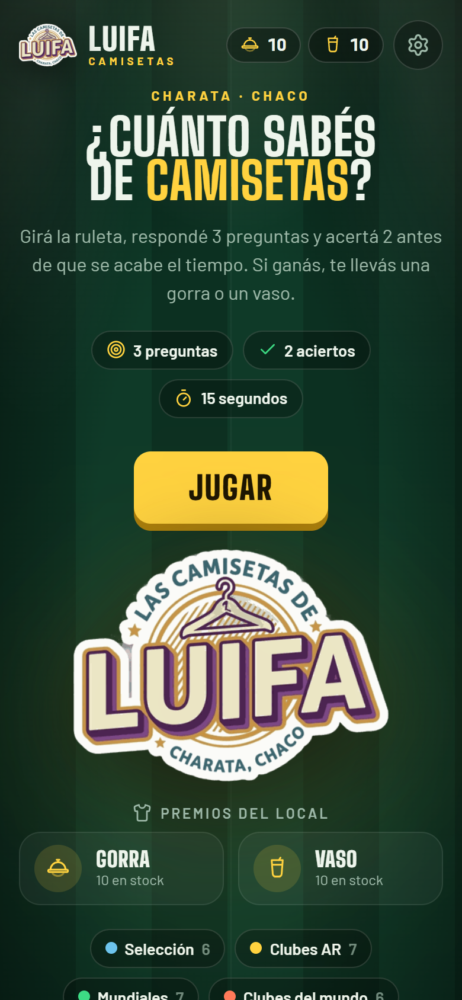 | 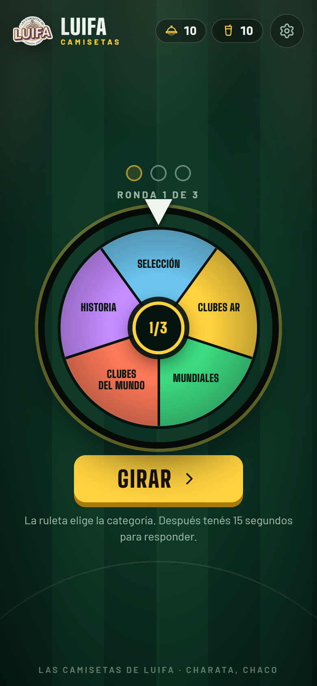 |

## Despliegue

**Opción A — frontend estático + backend gestionado**

1. Subí `frontend/` a Vercel, Netlify o Cloudflare Pages con `VITE_API_URL=https://tu-api.ejemplo.com/api/v1`.
2. Desplegá `backend/` en Railway, Render, Fly.io o cualquier host con Java 25 y PostgreSQL.
3. Configurá `SPRING_PROFILES_ACTIVE=postgres`, las credenciales de la base, `ADMIN_PIN` y `CORS_ALLOWED_ORIGINS=https://tu-frontend.ejemplo.com`.

**Opción B — un solo servidor con Docker Compose**

Copiá el repositorio al servidor, creá el `.env` de producción y levantá `docker compose up -d --build` detrás de un reverse proxy con HTTPS (Caddy, Traefik o nginx).

Recomendaciones para producción:

- Cambiar el PIN por defecto y usar una contraseña de base de datos fuerte.
- Servir todo por HTTPS.
- Desactivar Swagger y la consola H2 si no los necesitás (`SPRINGDOC_API_DOCS_ENABLED=false`, `SPRINGDOC_SWAGGER_UI_ENABLED=false`; el perfil `postgres` ya desactiva H2).
- Programar backups del volumen de PostgreSQL.

## Seguridad

- El PIN de administración es una **barrera operativa** para una tablet detrás del mostrador, no un sistema de autenticación para exponer el panel a internet.
- El PIN se envía en el header `X-Admin-Pin` y se guarda solo en `sessionStorage`; nunca forma parte del bundle ni de la base de datos.
- Si el juego va a estar accesible desde internet, poné el panel detrás de HTTPS y de una capa de autenticación real (VPN, reverse proxy con basic auth, Cloudflare Access, etc.).
- Cambiá `ADMIN_PIN` y `POSTGRES_PASSWORD` antes de publicar. No commitees el archivo `.env`.
- La API aplica CORS solo a los orígenes configurados. En Docker, el navegador usa el mismo origen a través de nginx, así que no hace falta abrir CORS a toda la red.

## Reset de datos

- **Local (H2):** detené el backend y borrá la carpeta `backend/data/`. Al reiniciar se vuelve a crear con el stock 10/10 y las 32 preguntas.
- **Docker (PostgreSQL):** `docker compose down -v` y luego `docker compose up -d --build`.

## Licencia

Código publicado bajo licencia [MIT](LICENSE). El nombre, el logo y la identidad de **Las Camisetas de Luifa** pertenecen a su dueño.
