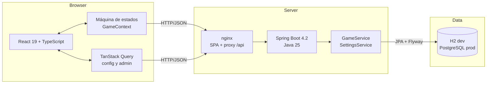
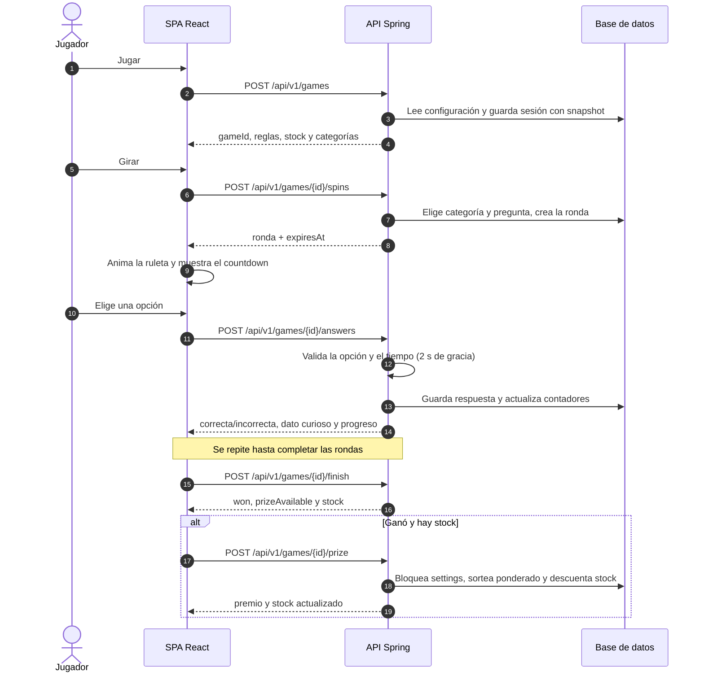
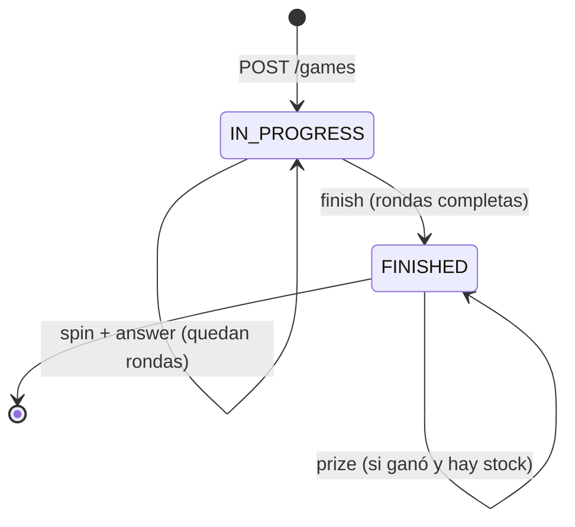
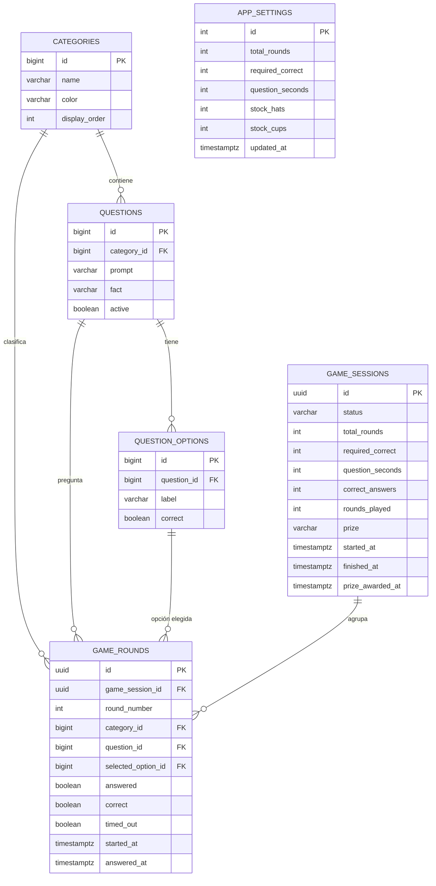

# Arquitectura

## 1. Objetivo

El juego original era un único archivo HTML con todo el estado en el navegador: preguntas, respuestas correctas, temporizador y stock. Eso alcanza para una demo, pero no para usarlo en el local: cualquiera puede ver las respuestas en el código, recargar para reiniciar el tiempo o modificar el stock.

Esta versión mueve las reglas y los datos al servidor. El navegador es una interfaz de juego; la API es la dueña de la verdad.

## 2. Vista general



En desarrollo, Vite hace de servidor y proxya `/api` a `localhost:8080`. En Docker, nginx sirve los archivos estáticos y proxya `/api` al contenedor `backend`, de modo que el navegador trabaja siempre contra un único origen y no hay problemas de CORS. Además, nginx elimina el header `Origin` en las llamadas a `/api`, así que el juego funciona igual entrando por `localhost`, por `127.0.0.1` o por la IP de la tablet en la red local.

## 3. Backend

### 3.1 Organización por dominio

| Paquete | Responsabilidad |
| --- | --- |
| `game` | Sesiones, rondas, respuestas, finalización y sorteo del premio |
| `catalog` | Categorías, preguntas, opciones y consultas de preguntas jugables |
| `settings` | Reglas de la partida y stock, con validación y bloqueo optimista/pesimista |
| `admin` | Estadísticas agregadas del local |
| `security` | Interceptor que exige `X-Admin-Pin` en `/api/v1/admin/**` |
| `seed` | Banco de 32 preguntas y carga inicial idempotente |
| `common` | Excepciones de API, códigos de error y `@RestControllerAdvice` |
| `config` | Propiedades, CORS, `Clock` y `Random` inyectables, OpenAPI |

La separación es por funcionalidad, no por capa técnica. Cada dominio tiene sus entidades, repositorios, servicios y DTOs de API.

### 3.2 Flujo de una partida



Puntos importantes:

- **La ruleta es visual.** El servidor ya eligió la categoría antes de la animación; el frontend calcula el ángulo final para que la rueda caiga exactamente en esa categoría.
- **El temporizador es del servidor.** La respuesta incluye `expiresAt`; el cliente muestra el tiempo restante derivado de ese instante. Al vencer, envía `optionId: null` y el backend registra timeout.
- **Las opciones se mezclan en el servidor** en cada respuesta de ronda. El orden del banco de preguntas no revela cuál es la correcta.
- **El cliente nunca recibe la respuesta correcta antes de responder.** El `AnswerResponse` recién ahí incluye `correctOptionId`, `correctOptionLabel` y el dato curioso.

### 3.3 Estados de una partida



- `IN_PROGRESS`: se pueden girar rondas y responder.
- `FINISHED`: ya no se aceptan respuestas; el resultado es estable.
- El premio no cambia el estado de la sesión: queda registrado en `game_sessions.prize` y `prize_awarded_at`.

### 3.4 Modelo de datos



El esquema se versiona con **Flyway** (`backend/src/main/resources/db/migration`). Hibernate corre con `ddl-auto=validate`: no crea ni modifica tablas por su cuenta, solo verifica que las entidades coincidan con las migraciones.

## 4. Decisiones de diseño

### Servidor autoritativo

Todas las decisiones sensibles viven en la API: categoría, pregunta, opciones, respuesta correcta, timeout, premio y stock. El frontend no contiene el banco de preguntas ni la lógica de negocio. Esto evita trampas triviales y permite que la misma API sirva a una futura app o a una pantalla secundaria.

### Snapshot de configuración por partida

Al crear una partida se copian `total_rounds`, `required_correct` y `question_seconds` a `game_sessions`. Si el dueño cambia las reglas desde el panel mientras alguien está jugando, esa partida conserva sus reglas originales. El stock, en cambio, es global y se consulta en vivo, porque representa unidades físicas del local.

### Idempotencia

- Responder una ronda ya respondida devuelve el mismo `AnswerResponse` sin volver a sumar aciertos.
- Sortear el premio de una sesión que ya tiene premio devuelve el mismo premio y el stock actual, sin descontar de nuevo.

Esto hace seguros los dobles clics, los reintentos por red y los botones que se disparan dos veces.

### Ventana de gracia

`ANSWER_GRACE` es de **2 segundos**. Sin esa ventana, un jugador con buena conexión pero latencia normal podría perder por unos milisegundos. El cliente envía la respuesta al vencer su countdown local; el servidor acepta la respuesta dentro de `expiresAt + 2 s` y, pasado ese margen, la marca como timeout. La gracia no se muestra en la UI: el jugador ve el tiempo real de la ronda.

### Sorteo ponderado y concurrencia

El premio se elige con una probabilidad proporcional al stock:

```text
P(gorra) = stock_gorras / (stock_gorras + stock_vasos)
P(vaso)  = stock_vasos  / (stock_gorras + stock_vasos)
```

Antes de sortear se bloquea la fila de configuración (`SELECT ... FOR UPDATE`) y también la sesión. Así, dos sorteos simultáneos no pueden descontar dos veces la misma unidad ni dejar el stock negativo. Lo mismo aplica a las respuestas: la sesión se bloquea durante la transacción.

### Aleatoriedad y repetición de preguntas

- La categoría se elige al azar entre las que tienen preguntas activas.
- Dentro de la categoría se evitan preguntas ya usadas en la misma partida; si no alcanzan, se permite repetir.
- Las opciones se barajan en cada respuesta de ronda.
- `Clock` y `Random` son beans inyectables, lo que permite tests deterministas.

### H2 y PostgreSQL

- **Desarrollo:** H2 en modo archivo con `MODE=PostgreSQL;DATABASE_TO_LOWER=TRUE`, para que el SQL de Flyway sea compatible con ambos motores.
- **Producción:** perfil `postgres` con PostgreSQL 17, pool Hikari de 10 conexiones y consola H2 deshabilitada.
- **Tests:** H2 en memoria, esquema creado por la misma migración Flyway que usa producción.

### Panel de administración

El PIN se envía en el header `X-Admin-Pin` y se valida en un interceptor para todo `/api/v1/admin/**`. En el frontend se guarda solo en `sessionStorage`, así que se pierde al cerrar la pestaña y nunca forma parte del bundle.

Es una protección adecuada para una tablet detrás del mostrador, **no** un sistema de autenticación para exponer el panel a internet. Para un despliegue público conviene ponerlo detrás de HTTPS y de una capa de autenticación real (VPN, reverse proxy con basic auth, Cloudflare Access, etc.).

### Errores

La API usa `ProblemDetail` (`application/problem+json`) con:

- `title`, `detail`, `status`, `instance` y `timestamp`.
- `code` estable para el frontend: `GAME_NOT_FOUND`, `ROUND_NOT_FOUND`, `INVALID_OPTION`, `OUT_OF_STOCK`, `VALIDATION_ERROR`, etc.
- `errors` con el detalle por campo cuando falla Bean Validation.

## 5. Frontend

### Máquina de estados

`GameContext` mantiene la fase actual:

```text
home → wheel → question → result → prize
  ↑       ↑         │         │
  └───────┴─────────┴─────────┘  (reinicio / siguiente ronda)
```

- `GameView` decide qué pantalla mostrar.
- Las acciones (`starting`, `spinning`, `answering`, `finishing`, `drawing`) bloquean dobles envíos con un `ref`, no solo con estado de React.
- El estado del servidor (config, admin) se maneja con TanStack Query; el estado efímero de la partida vive en el contexto.

### Ruleta

`src/lib/wheel.ts` calcula el ángulo de destino a partir de la categoría devuelta por el servidor. La animación usa CSS y `requestAnimationFrame`; al terminar, se muestra la pregunta. La lógica está cubierta con tests unitarios.

### Tiempo y experiencia

- `useCountdown` deriva los segundos restantes de `expiresAt`, no de un contador acumulativo.
- `useWakeLock` mantiene la pantalla encendida durante la partida cuando el navegador lo permite.
- `useReducedMotion` desactiva confetti y animaciones intensas si el sistema lo pide.
- Los botones y opciones tienen foco visible, etiquetas ARIA y estados deshabilitados durante los envíos.

## 6. Testing

| Nivel | Herramienta | Cobertura |
| --- | --- | --- |
| Backend | JUnit 5 + MockMvc + `@SpringBootTest` | Flujo ganador y perdedor, timeout, idempotencia, opción inválida, stock agotado, PIN, settings y estadísticas |
| Backend | JUnit 5 | Sorteo ponderado con `Random` determinista |
| Frontend | Vitest | Cálculo de ángulos y selección de categoría de la ruleta |
| Frontend | Testing Library | Render de componentes y estados principales |
| CI | GitHub Actions | `mvn verify`, lint, tests, build y build de imágenes Docker |

## 7. Operación

- **Health check:** `GET /actuator/health` (expuesto sin detalles).
- **Logs:** Spring Boot escribe en consola; en Docker se consultan con `docker compose logs -f backend`.
- **Backups:** el volumen `postgres-data` contiene toda la información. En producción, programar `pg_dump` periódico.
- **Escalado:** la API es stateless a nivel HTTP y puede correr con varias instancias contra PostgreSQL. H2 en archivo está pensado para una sola instancia.
- **Datos de demo:** el seeding es idempotente; si ya hay preguntas, no vuelve a cargarlas. Borrar `backend/data/` o el volumen de PostgreSQL reinicia todo a los valores por defecto.

### Límites conocidos

- No hay cuentas de jugador ni ranking histórico; cada partida es anónima.
- Si el jugador recarga la página, el frontend pierde la sesión en curso (el backend conserva la partida, pero no hay endpoint para retomarla).
- No hay tarea programada de limpieza de sesiones antiguas; para un local con mucho volumen conviene agregarla.
- El PIN es una barrera operativa, no autenticación fuerte.
